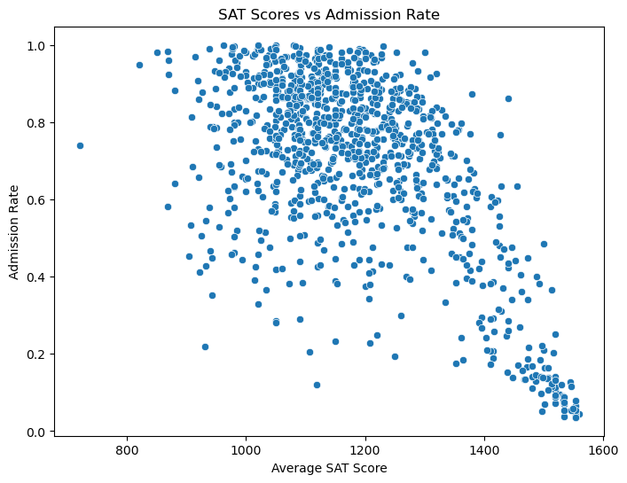
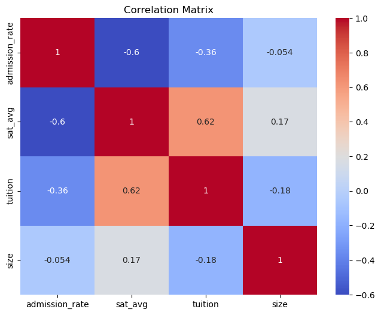
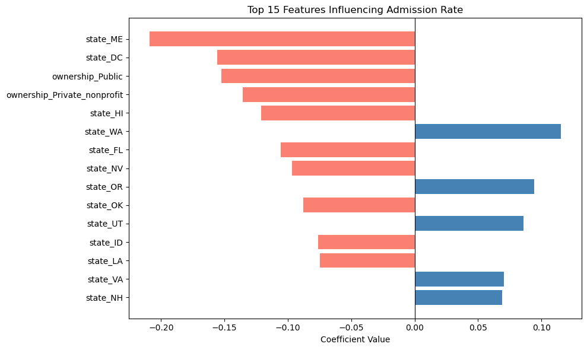
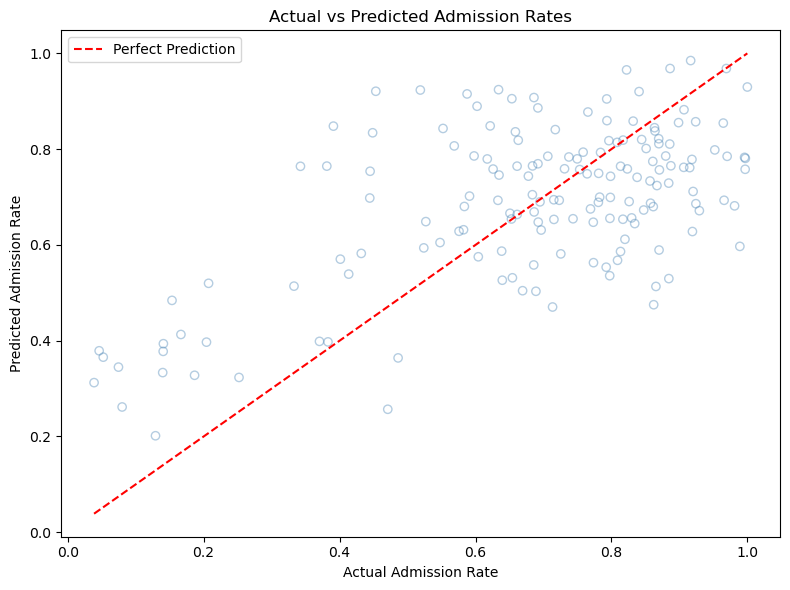

# What Predicts College Admission Rates?

**An econometric analysis of 6,300+ U.S. colleges using the Department of Education's College Scorecard API**

*ECON 300 Final Project · Grace Orrick · University of Tennessee, Haslam College of Business*

---

## Research Question

What institutional characteristics predict how selective a college is? This project tests how standardized test scores, tuition, enrollment size, ownership type (public, private nonprofit, private for-profit), state, and region relate to a school's admission rate.

## Approach

1. **Data collection.** I wrote a Python script that pages through the U.S. Department of Education [College Scorecard API](https://collegescorecard.ed.gov/data/api/) and pulls admissions, cost, enrollment, and location data for **6,322 institutions**.
2. **Cleaning and feature engineering.** I renamed and selected variables, mapped ownership codes to labels, dropped records missing critical fields, and one-hot encoded state, ownership, and region (`drop_first=True` to avoid perfect multicollinearity). That left 1,801 schools with admissions data.
3. **Exploratory analysis.** I built scatterplots, a distribution plot, and a correlation matrix to check relationships before modeling.
4. **Modeling.** I fit an OLS linear regression on the 806 schools reporting both SAT and ACT scores, using an 80/20 train/test split to evaluate out-of-sample performance.

## Key Results

| Metric | Value |
|---|---|
| Out-of-sample R² | **0.372** |
| Mean Squared Error | 0.034 (≈ 18 percentage point average error) |

- **Test scores are the strongest single predictor.** The correlation between average SAT and admission rate is **−0.60**. Schools averaging above 1400 on the SAT almost all admit fewer than 40% of applicants.
- **Tuition matters less than it seems.** Tuition correlates with admission rate at −0.36, but it's also strongly correlated with SAT scores (0.62), so the two effects partly overlap.
- **Ownership type and location matter.** Holding other factors constant, public and private nonprofit schools admit roughly 14–15 percentage points fewer applicants than for-profit schools, and state effects make up much of the top 15 coefficients.
- **The model struggles with the most selective schools.** It consistently over-predicts admission rates below 40%. That suggests prestige, endowment, and applicant yield, none of which are in the Scorecard data, drive much of elite selectivity.

<p align="center">
  
  
</p>
<p align="center">
  
  
</p>

## Limitations

- Schools that don't report SAT/ACT scores are excluded, which may bias results toward test-focused institutions.
- The model shows associations, not causal effects.
- Admission rates are right-skewed (most schools admit 70%+), which limits a linear model at the selective end.
- Future work could add faculty-to-student ratio, endowment, or yield, or try a model better suited to a bounded outcome (e.g., fractional logit).

## Repository Structure

```
├── notebooks/
│   └── econ300_college_admissions.ipynb   # Full analysis: API pull → cleaning → EDA → regression
├── data/
│   ├── raw/college_admissions.csv         # Raw API output (6,322 schools)
│   └── clean/college_model_ready.csv      # Cleaned, one-hot encoded dataset
├── images/                                # Charts used in this README
└── requirements.txt
```

## How to Run

```bash
pip install -r requirements.txt
```

The cleaned data is included, so you can run the analysis cells without an API key. To re-pull the raw data, get a free key at [api.data.gov/signup](https://api.data.gov/signup/) and set it before launching Jupyter:

```bash
export SCORECARD_API_KEY="your_key_here"
jupyter notebook notebooks/econ300_college_admissions.ipynb
```

**Tools:** Python · pandas · requests · scikit-learn · matplotlib · seaborn · Jupyter
